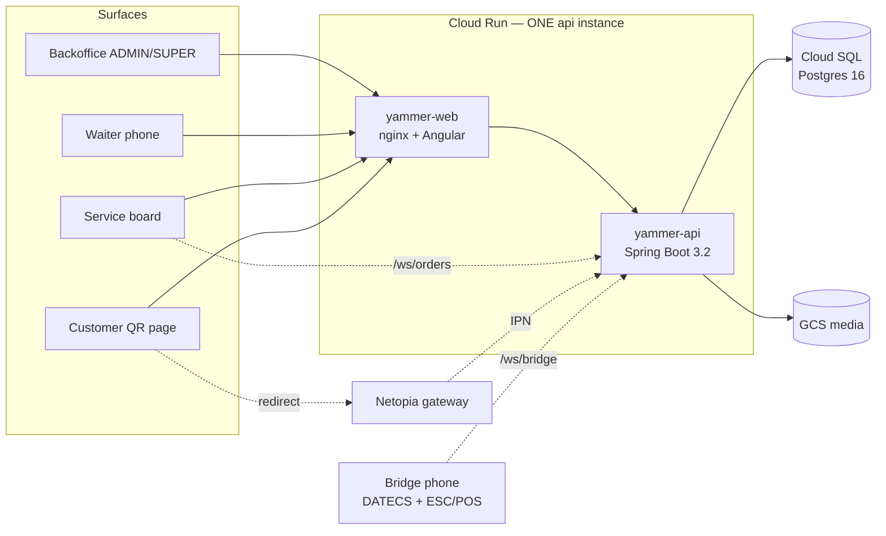

# Codebase audit — design & findings register

Epic: [#1](https://github.com/Pezu/yammer-app/issues/1) · Owners: `architect-a` (author),
`architect-b` (second signature) · Phase 1 deliverable

Companion documents: `requirement.md` (`ba`), `test-plan.md` (`qa`), `ux.md` (`ux` — the UX/UI
track lives there; this document carries the architecture and defect tracks).

Audited at `develop` = `628c193`. Every finding carries file:line evidence verified by both
architects; severities follow `requirement.md`'s scheme, and a violation of a CLAUDE.md §5 gate
is graded at least **major** regardless of practical likelihood (see §8, A7, for why that rule
is applied mechanically).

---

## 1. Context

The audit confirmed the two pillars the system leans on are sound and must not be disturbed:

- **The fiscal outbox** (`payment.fiscal_status`): guarded, atomic transitions
  (`PaymentRepository.java:70-127`), SUCCESS terminal, no automatic retry, AFTER_COMMIT dispatch
  with REQUIRES_NEW DB steps (`BridgeService.java:102-110`), bridge-side exactly-once journal.
- **Tenancy through `AccessGuard`** (`security/AccessGuard.java`): systematic across services,
  cross-tenant = 404. The findings below are exceptions to, not an absence of, this pattern.

Everything in this register is a deviation from those standards or from CLAUDE.md §5.

## 2. Findings register — defects and architecture

Owner codes: BE = backend, FE = frontend, DO = devops, DOC = documentation change.
IDs: `A-*` api (architect-a), `W-*` web, `B-*` bridge, `I-*` infra (architect-b),
`QA-*`/`F-*` qa's coverage audit (`test-plan.md` §10). Merged findings list every id.

### 2.1 Critical

| ID | Finding | Evidence | Fix (design in §3; B-T1 → §3.8, F-5 → §3.9, W2 → §3.10) | Owner |
|---|---|---|---|---|
| A1 | **Forged Netopia IPN creates paid orders.** `/public/payments/netopia/notify` is permitAll and `handleIpn` performs no authenticity check; the amount check runs **only when the IPN carries an amount**, so the bypass is an *absent* field, not a matching value; and the only identifier needed is the intent ref, which the customer's own browser already holds (the return page polls it). So this is not an attacker guessing a UUID — it is **any customer confirming their own unpaid order with one unauthenticated POST**: an ORDERED order + SUCCESS payment, **and a real fiscal receipt prints** for money never received — goods theft *and* tax exposure. `deploy.yml` sets `NETOPIA_ENABLED=true` in prod, so the endpoint is live today. (The sandbox `NETOPIA_BASE_URL` pin in the same deploy is **deliberate** per the human's decision D6 — noted as intent, not a defect; a go-live switch task sits in the backlog.) Reproduction: `test-plan.md` R-O5b. | `SecurityConfig.java:44`; `OnlinePaymentService.java:111-158` (amount skip 135-141, ref leak 210-212); `BridgeService` fires on `PaymentCommittedEvent`; `.github/workflows/deploy.yml:70` | §3.1 — verify IPN authenticity + reject confirmed IPNs without an amount. **Human gate (payments).** | BE + DO |

### 2.2 Major

| ID | Finding | Evidence | Fix | Owner |
|---|---|---|---|---|
| A2 | **Double-payment race.** `pay()` reads unpaid lines then stamps/splits them with no locking anywhere in the codebase (no `@Version`, no `FOR UPDATE`). Two concurrent payments on one table each create a SUCCESS payment + fiscal receipt over the same lines. | `OrderService.java:446-476` read, 480-487/497-561/565-613 stamp paths; class-level `@Transactional` only (`:59`) | §3.2 — guarded conditional UPDATEs (ADR-0001) | BE |
| A3 | **Duplicate order numbers.** `order_no` = `maxOrderNoForClient+1` under concurrency, and V1 has no unique constraint on `orders.order_no`. | `OrderService.java:109,176,344`; `ApprovalService.java:131`; `V1__Initial_schema.sql` (orders) | §3.3 — atomic per-client counter; fix covers all four call sites | BE |
| A4 (=W1) | **Waiter order lines trust the client.** `place()` stores request-supplied name + price verbatim and never validates `menuItemId`; the web sends prices from a localStorage menu cache with **no TTL** (manual "Refresh menu"/logout only). Everyday failure: a backoffice price change never reaches the phones — stale prices are charged and fiscalized indefinitely. Tail risk: any authenticated user can post arbitrary prices; a foreign `menuItemId` also skews the VAT resolved for the receipt. The customer flow already resolves server-side. | `OrderService.java:118-127`; `dto/OrderItemRequest.java`; `web/src/app/features/waiter/waiter-menu-cache.service.ts:17-21`; VAT: `BridgeService.java:490-522` | §3.4 — server-side resolution on the waiter path + cache versioning | BE + FE |
| A5 | **CANCELED hides settled money.** `updateStatus` accepts CANCELED for an order with PAID lines — the lines leave the bill (`NOT_BILLABLE`) while the SUCCESS payment and fiscal receipt remain; it also allows CANCELED→ORDERED resurrection. | `OrderService.java:701-716`, `:64-68` | §3.5 — 409 when any line is paid; restrict transitions | BE |
| A6 | **Orders report "paging" is in-memory.** Every page view loads ALL the location's orders + ALL their items, filters in streams and `subList`s; `filterOptions` loads every order to list distinct waiters. Unbounded growth on a 1 GiB single instance; latent at today's volume, certain to degrade. | `OrderReportService.java:54-78, 82-106` | §3.6 — real `Pageable` SQL + distinct queries | BE |
| A7 | **Tenancy invariant break: 403 instead of 404.** `decideCustomer`/`decideOrder`/`setSelfOrderMode` load by id and answer 403 "Not assigned to this table" for cross-tenant ids, disclosing that the id exists. Practical impact is low (UUID ids); graded major because §5's "cross-tenant = 404, never 403" is a hard gate and grading invariant breaks by guessed likelihood re-litigates the invariant per-finding. | `ApprovalService.java:101-158` | Tenant-guard the order point via `AccessGuard` first (404), keep `requireAssigned` (403) for same-tenant callers | BE |
| A8 | **Server-rendered times are UTC.** No TZ is set anywhere; `LocalDateTime.now()` feeds thermal cash-up slips and the waiter PDF statements — printed times run 2–3 h behind Romania, a recurring staff-dispute generator. Browser-rendered times are unaffected (instants converted client-side). | no TZ in `deploy.yml` / `api/Dockerfile` / `application.yml`; `ShiftService.java:58, 277`; `WaiterStatementPdfService` | `TZ=Europe/Bucharest` env in `deploy.yml` AND `docker-compose.local.yml` (parity), noted in both CLAUDE.md files. The `Instant`+zone refactor is out of this epic's scope (see §9 Alternatives) | DO + DOC |
| A9 (=W4, QA-02..QA-18) | **Money, permissions and tenancy are untested.** `OrderService.pay` (all three modes), the fiscal transitions and the RECEIPT frame content, `AccessGuard`, the 56 `@PreAuthorize` rules, the Netopia IPN invariant, the bridge journal: zero tests; web has one trivial spec. `mvn test` is red without a local Postgres (QA-03), and no DB-backed test level exists at all (QA-02) — the fiscal state machine is WHERE clauses nothing executes. CLAUDE.md §5.6 names exactly these as must-test. | qa's register (QA-nn series; `test-plan.md` §10 is authoritative for ids) | The QA/test-debt track: qa's "minimum set" becomes stories (CI first — I1); the test-datasource strategy (QA-02+QA-03) is ONE design decision taken in the ci.yml task. qa's note: the compose stack's `BRIDGE_API_KEY` lets a scripted WS client drive RECEIPT_RESULTs, so integration-level fiscal paths are testable before a DB test level lands | BE + FE + QA |
| F-8 | **Fiscal re-issue reachable by read-only roles.** `OrderPointAssignmentController` is `isAuthenticated()` at class level and its `retry-fiscal` endpoint delegates to the tenant-guard-only service path — so SERVICE and **WATCHER (documented read-only)** can trigger a fiscal re-print for any payment of their tenant. Two doors to one service method, role-guarded on only one (`PaymentController` is correctly ADMIN/SUPER). Major, not critical: the action is a guarded FAILED-only re-arm, dedup-safe and tenant-scoped — an unauthorized actor causes a legitimate re-print, never wrong money. | `OrderPointAssignmentController.java:30, 91-95`; `PaymentService.java:134-147` | one-line `@PreAuthorize("hasAnyRole('WAITER','ADMIN','SUPER')")` on the endpoint; `test-plan.md` R-R1f asserts per role | BE |
| B-T1 | **The bridge layer is tenant-blind.** (a) `GET /bridge/devices` lists EVERY tenant's connected phones to any ADMIN; (b) TCP-register receipts route to ANY connected bridge (`targetDevice=null` = "any device"), so the moment a second tenant connects a bridge, tenant A's fiscal frames can land on tenant B's phone — which cannot reach A's register LAN, so receipts fail non-deterministically; (c) nothing validates that a peripherals row's `device_id` belongs to the writer's tenant, so cross-tenant fiscal routing is configurable. Tenancy invariant + fiscal reliability; latent while only one tenant has a bridge. | `BridgeController.java:19-23`; `BridgeService.java:93` (Waiting.targetDevice null = any), `onDeviceRegistered`; `IntegrationService.java:69-74` (deviceId unvalidated) | §3.9 — bind device ids to a client at pairing time; routing and the device list filter by the payment's/caller's client | BE |
| I1 (QA-01) | **No `ci.yml`.** Nothing builds or tests a PR; §6's "CI green" merge condition is unenforceable; `api/Dockerfile` builds with `-DskipTests`. | `.github/workflows/` contains only `deploy.yml` | §3.7 — `ci.yml` is the FIRST task of the epic, blocking every fix story | DO |
| F-5 | **AMOUNT payments ignore the table's discount** (deliberate in code; the human decided it is a defect — decision D5): on a 10%-discounted table holding one 42.00 pizza, FULL settles at 37.80 but AMOUNT 37.80 covers no whole gross unit, splits it, and the table still owes 4.20 — the customer pays gross and the bill looks unsettled. | `OrderService.java:565-578, 471-473`; qa's worked example (R-M6) | §3.10 — `payAmount` allocates against NET discounted unit prices like FULL/PARTIAL and records the discount fields; ships with the A2 settle work (same method). Bug #5 tracks it | BE |
| I6 | **Spring Boot 3.2.1 is EOL.** OSS support for the 3.2 line ended; the public API sits behind framework/Security lines with published fixes (Tomcat already pinned forward to 10.1.42). | `api/pom.xml:11` (`:31` tomcat override) | Upgrade to the current supported Boot line (target named by architect-b in the task); sequenced AFTER I1 so the bump lands with CI. **Human gate (dependency).** | BE + DO |
| I9 | **Release/Flyway reconciliation risk.** `origin/main` (451248a) still ships the 46 pre-fold migrations; `origin/develop` (628c193) ships the folded `V1`/`V2`. Whatever state prod's database is in, one of two failures is pending: instance restarts failing validation now, or the next `develop → main` release failing Flyway validation at prod startup. | `git log origin/main..origin/develop`; `api/CLAUDE.md` "Database" section | **Human gate (release):** the human confirms prod's DB migration state before any release; a flyway repair/baseline plan goes in `docs/runbook.md` (devops prepares it) | human + DO |
| W2 (=A13-jwt) | **Session JWT in the WebSocket URL.** The board connects to `/ws/orders?token=<jwt>`; tokens live 24 h and the client reconnects every 3 s when down, so valid staff tokens are continuously written into nginx/Cloud Run request logs, readable by anyone with log access. | `service-page.ts:205`; `WsAuthHandshakeInterceptor.java:31-33`; `application.yml:41` | §3.8 — single-use 30 s WS ticket (ADR-0002) | BE + FE |

### 2.3 Minor

| ID | Finding | Evidence | Fix | Owner |
|---|---|---|---|---|
| A10 | Single-user point race: `assign()`/`selectStation()` check-then-insert lets two users take a single-user table | `OrderPointAssignmentService.java:294-307, 250-276` | re-check count after insert in the same tx; 409 + rollback on violation | BE |
| A11 | Concurrent implicit shift open → unique-index 500 for one caller | `ShiftService.java:212-224` | catch the unique violation, re-read the winner | BE |
| A12 | Shift close check-then-act: an order can slip onto a closing day between the open-tables check and the commit | `ShiftService.java:175-197` | re-check `openTables` count in the same statement as the close, or accept + document (tiny window, money stays visible) | BE |
| A13-key | Bridge `?key=` query fallback puts the API key in request logs; the bridge app always sends the header | `BridgeAuthHandshakeInterceptor.java:60-64` | drop the query fallback | BE |
| A14 | Unthrottled `POST /public/order-points/{opId}/join` creates unbounded PENDING `customer_session` rows (approvals-page spam + table growth); stale/DENIED rows are never cleaned | `CustomerAccessService.java:43-54` | per-IP+point throttle (reuse the `LoginAttemptService` pattern), cap PENDING per point, scheduled cleanup of dead rows | BE |
| A15 | Waiter `retry-fiscal` is tenant- but not assignment-scoped: any **waiter** can re-issue any FAILED receipt of their client | `PaymentService.java:134-147` | **Keep as-is, document** (waiter-to-waiter scope): a recovery action through the same guarded re-arm as the backoffice button; the bridge dedups by `requestId`; scoping buys nothing across shift handovers. The ROLE hole on the same door (SERVICE/WATCHER) is F-8 above and IS fixed. `test-plan.md` tags its scenario with this decision | DOC |
| I11 | `NetopiaPaymentService.startPayment` builds a `RestClient.create()` per call with no connect/read timeout, invoked inside the `@Transactional` `start()` — a hung gateway holds a DB connection and a request thread on the single instance | `NetopiaPaymentService.java:47` | one configured `RestClient` bean with timeouts; move the HTTP call out of the transaction. Folds into the A1 payments story (same files) | BE |
| F-3 | Per-IP login/QR throttle bypassable: `clientIp` trusts the FIRST `X-Forwarded-For` hop, which is client-controlled. Per-username throttle still holds; QR tokens are UUIDs, so brute force stays impractical — hence minor | `AuthController.java:69-75` | take the LAST hop (Cloud Run's LB appends the real client IP last), fall back to `remoteAddr` | BE |
| W3 | `index.html` served with no `Cache-Control` while hashed assets get 1 y immutable — a heuristically cached shell can reference deleted chunks after a deploy | `web/nginx.conf:48-51`, `web/nginx.local.conf` | `add_header Cache-Control "no-cache"` on the SPA fallback | DO |
| W5 | `combo-box` has no ARIA (role/aria-expanded), no Escape, no arrow keys; it sits on the public customer page | `web/src/app/shared/combo-box.ts` | routed to `ux` for the UX track; implementation FE | FE + ux |
| W6 | `auth.interceptor` bounces every 401 to `/login`, including on the public customer surface, and drops the current URL | `web/src/app/core/auth.interceptor.ts:20-24` | skip the bounce on public routes; preserve `returnUrl` | FE |
| W9 | `web/CLAUDE.md` layout drift: `watcher/`, `stats/`, `qr-templates/`, `reports/dashboard` exist undocumented; "Reports group [empty for now]" is stale | `web/CLAUDE.md` | doc fix, folded with A16 | DOC |
| I3 | `deploy.yml` has no `concurrency` group — two quick pushes to `main` can deploy out of order | `.github/workflows/deploy.yml` | one-line `concurrency:` block | DO |
| I5 (QA-03) | `scripts/env-up.sh`, `scripts/seed-tenant.sh`, `web/e2e/` referenced by CLAUDE.md don't exist; compose file + docs are untracked on `origin/develop` | `git ls-tree origin/develop`; CLAUDE.md §2/§7 | devops commits the stack + scripts (precondition for QA's Phase 4) | DO |
| B1 | Thermal TCP sink has no read/write timeout (connect timeout only): a wedged printer parks its single queue thread until app restart; the 180 s sweeper protects the money, not the bridge | `bridge/.../EscPosThermalService.kt:249-258`; `PrintQueueManager.kt` | soTimeout + bounded write | BE (bridge) |
| B2 | The 90 s job budget exists only on the fiscal path; INFO_RECEIPT / WAITER_REPORT / non-fiscal receipts have none — README overstates "a job is capped at 90 s" | `FiscalPrinterService` vs `EscPosThermalService` | same budget pattern on the thermal paths | BE (bridge) |
| B3 | `handleInfo`/`handleReport` `.exceptionally` blocks never answer the frame (violates "every inbound frame is answered"); `handleReceipt` does it right | `BridgeWebSocketClient.kt` | answer BRIDGE_INTERNAL like `handleReceipt` | BE (bridge) |

### 2.4 Trivial

| ID | Finding | Fix |
|---|---|---|
| A16 (+I4, F-1, F-2, F-7, W9) | Doc drift, all in one task: `api/CLAUDE.md` self-contradicts on shift stamping (the `shift_id` paragraph is the truth; the "NOT stamped"/`windowFor`/`BUSINESS_DAY_CUTOFF_HOUR` text describes removed code); claims login is restricted to ADMIN/SUPER via `AuthService.ALLOWED_LOGIN_ROLES`, which does not exist — any user with ≥1 role may log in (**intended**, human decision D7; doc fix #6); says Cloud Run "min 1 / max 2" where `deploy.yml` correctly pins `--max-instances 1` (the single-instance invariant — the DOC is wrong, never "fix" the workflow); never mentions the bridge offline queue (`BridgeService.waiting`) while saying "sends it ONCE / no automatic retry ever" — F-7, the omission that misled qa's first fiscal scenarios; `web/CLAUDE.md` layout drift (W9). | DOC |
| A17 (=F-6) | `createPayment` resolves the payment type twice | fold into the A2/A3 touch of the same method |

### 2.5 Notes (block nothing, recorded for posterity)

- **B4**: the bridge's 90 s budget starts at job start, not frame arrival — a burst of 3+ receipts
  to one register can push the last past the 180 s deadline; the sweeper FAILs it, the print still
  happens, and a manual retry answers from the bridge's dedup cache with the original OK. Self-healing; accepted.
- **B5**: `processed-receipts.jsonl`'s 7-day TTL also expires unresolved INTENT lines; no realistic
  re-send path exists after 7 days (retry is FAILED-only), so accepted.
- **B6**: bridge API key in SharedPreferences / optionally BuildConfig — acceptable for a
  provisioned on-prem device.
- **W7**: waiter toasts surface raw server reasons in English — by design per the error model;
  RO-speaking waiters see English on failures. Candidate for the UX track, not this register.
- **W8**: the service board reloads fully per WS event; a ~250 ms debounce would cut burst load.
- **I7**: iText 7.2.5 is AGPL — flag to the human for a licensing check at a convenient time.
- **N1**: `ShiftService.close` computes the cash-up before stamping `closed_at` — a payment
  committing in that window can miss the printed slip (the dashboard re-print shows it).
- **N2**: `OrderNotificationService.recipients` loads all the location's users per event; fine
  at today's cardinality, batches if boards grow.
- **N3**: receipt VAT is resolved at dispatch time, not payment time — a VAT change between pay
  and a manual retry prints the new rate.
- **N4**: `MenuService.reconcile` saves per node; a large tree save is chatty. Editor-path only.

## 3. Implementation designs (accepted majors)

### 3.1 A1 — Netopia IPN verification (one story with the sandbox-pin resolution)

- **Contract**: `POST /public/payments/netopia/notify` additionally reads Netopia's
  `Verification-token` header — a JWT signed by Netopia; the service verifies it against
  Netopia's published public key (cached, keyed by `netopia.base-url` environment) **before**
  `handleIpn` runs. Missing/invalid token → 403, intent untouched, logged at WARN.
- A confirmed-status IPN (3/5) **without** an amount is rejected (`markFailed` is NOT applied —
  the intent stays PENDING so a legitimate retried IPN can still land).
- Config: `netopia.ipn-public-key` (env `NETOPIA_IPN_PUBLIC_KEY`, Secret Manager in prod);
  fail-fast at startup when `netopia.enabled=true` and the key is absent (same pattern as
  `JwtService`'s dev-secret check).
- **Deploy half (human console steps prepared by devops)**: either go live (real
  `NETOPIA_BASE_URL` + live secrets) or set `NETOPIA_ENABLED=false` until go-live; the current
  enabled+sandbox combination is the one state that must not survive this epic.
- `NetopiaPaymentService` hardening rides along (I11): one configured `RestClient` bean with
  connect/read timeouts; the gateway call moves out of the `start()` transaction.
- Tests: the `R-O` suite in `test-plan.md` (valid IPN exactly-once, replay, amount mismatch,
  confirmed-without-amount = R-O5b, expiry, post-fix authenticity scenarios).

### 3.2 A2 — guarded conditional UPDATEs for settlement (ADR-0001)

- New `OrderItemRepository` methods, house pattern of `PaymentRepository`'s fiscal transitions:
  - `int settle(UUID id, UUID paymentId)` → `UPDATE order_item SET payment_id = :paymentId
    WHERE id = :id AND payment_id IS NULL`
  - `int reduceQuantity(UUID id, int expected, int newQty)` → `... SET quantity = :newQty
    WHERE id = :id AND quantity = :expected AND payment_id IS NULL`
  - a guarded delete for the fully-redistributed line (`AND quantity = :expected AND payment_id IS NULL`).
- `payFull` / `payPartial` / `payAmount` apply their plans through these; **any 0-row result
  throws 409 "The bill changed — review and retry"**, rolling back the payment row and any split
  inserts with it. The loser re-reads a fresh bill; no money is ever double-settled.
- `OrderReportService.updateItems` adopts the same guards (it mutates unpaid lines outside
  `pay()` — the reason data-layer guards beat an advisory lock; see ADR-0001).
- Tests: `test-plan.md`'s concurrency scenarios (marked *expected to fail pre-fix*) go green;
  unit tests for the 0-row paths.

### 3.3 A3 — atomic per-client order numbers

- Migration `V3__Client_order_no_counter.sql`: `ALTER TABLE client ADD COLUMN next_order_no
  BIGINT NOT NULL DEFAULT 1;` backfilled with `max(order_no)+1` per client; plus a protective
  index `uq_orders_client_no` is NOT added (order rows don't carry client_id; the counter is the
  source of truth).
- `ClientRepository.nextOrderNo(UUID clientId)` → `UPDATE client SET next_order_no =
  next_order_no + 1 WHERE id = :id RETURNING next_order_no - 1` (native). Row-level lock on the
  client row serializes number allocation; the transaction that creates the order holds it only
  for the insert tail.
- All four call sites switch: `OrderService.place` / `placeCustomerOrder` /
  `createPaidOnlineOrder`, `ApprovalService.decideOrder`.
- Backward compatible: `order_no` stays `BIGINT`, numbering continues from the current max.

### 3.4 A4 — server-resolved waiter order lines + menu cache versioning

- **API contract (first, so BE and FE build in parallel):** `PlaceOrderRequest.items[*]` becomes
  `{menuItemId, quantity}` — `name`/`price` are removed. The server resolves name, price and VAT
  from the menu item exactly as `resolveCustomerOrderLines` does, validating the item belongs to
  a menu of the point's location. Free-text lines: *pending architect-b's verification of the
  waiter UI* — if the UI never sends `menuItemId = null`, the field pair is simply dropped; if a
  custom-line path exists, it stays as an explicit `{name, price}` variant **restricted to
  ADMIN/SUPER** so the open price entry is a manager action.
- Transitional tolerance: the API ignores (not rejects) `name`/`price` if present, so the old web
  build keeps working until the FE task lands (additive change, CLAUDE.md §5 gate).
- **FE:** `GET /order-points/{id}/menu` response gains a `menuVersion` (the max `updated_at`-style
  monotonic value; simplest: a per-menu counter bumped by `saveTree`). The bill response already
  flows to the table screen; it carries the same version, and the cache refetches when it moves.
- Fiscal impact: receipts can no longer carry tampered prices or foreign-tenant VAT.

### 3.5 A5 — kanban transition rules

- `updateStatus` refuses CANCELED when any line of the order has `payment_id` (409 with reason
  "Order has paid items — refund/handle them first", shown by the UI).
- Allowed transitions: `ORDERED↔READY`, `READY→DELIVERED`, `{ORDERED,READY}→CANCELED`,
  `DELIVERED→{READY,ORDERED}` is refused (resurrection), `CANCELED` is terminal.
- Live-push: unchanged — `OrderChangedEvent` still fires on every accepted transition.

### 3.6 A6 — real paging for the orders report

- `OrderRepository` gains a paged, filtered query (orderNo / orderPointId / createdBy filters in
  SQL, `Pageable` sort by `created_at DESC`); the `paid` tri-state filter needs the item
  aggregation, so it is computed per page, with the page size honest about post-filtering (same
  UX as today, server does the work). `filterOptions` becomes `SELECT DISTINCT created_by` + the
  existing points query.
- Hot paths (bill, board) are untouched — they are already bounded by the round/assignment scope.

### 3.7 I1 — `ci.yml` (first task, blocks all fix stories)

- `on: pull_request` (any base). Jobs: **api** — postgres:16 service container, `yammer` schema
  init, `mvn -B test` with dependency cache (fake-gcs only if the context proves to need it —
  *pending architect-b's check of `StorageConfig` startup behaviour*; if needed, the
  fake-gcs-server container joins the job); **web** — node 22, `npm ci`, `npm test -- --run`,
  `npm run build`; **bridge** — `gradle assembleDebug`, path-filtered on `bridge/**`.
- Required checks per CLAUDE.md §6; QA-01 (context test red without DB) is solved by the service
  container now and may later move to Testcontainers — not in this task.

### 3.8 B-T1 — bridge-to-tenant binding

- A bridge announces nothing tenant-bound in HELLO, so the binding happens at **pairing time**,
  where it already implicitly exists: a peripherals row (ADMIN-created, tenant-guarded) carries
  the `device_id`. Design: a device id used by any integration row of client X is *paired to X*;
  `GET /bridge/devices` returns unpaired devices plus devices paired to the caller's client
  (SUPER sees all); saving a peripherals row with a device id already paired to ANOTHER client
  is refused (409 naming nothing — the id simply "is not available").
- Routing: for `targetDevice=null` (TCP registers), `sendToAnyReturningDevice` filters to
  bridges paired to the **payment's** client (via its order point's location); an unpaired
  bridge receives nothing until an admin pairs it. The pinned `fiscal_device` already keeps
  re-dispatches on one device.
- The list filter is only cosmetic without the **write-side validation**: `IntegrationService`
  (today `:69-74`, which validates nothing) refuses saving a `device_id` already referenced by
  another client's integration rows — two clients referencing one device must be impossible at
  the data layer, not just hidden by the picker.
- **Behaviour change to state at rollout:** once any-bridge routing filters by the payment's
  client, a TCP-register receipt needs at least one bridge PAIRED to that client. A fresh venue
  with a connected-but-unpaired bridge will see receipts go PENDING → sweeper-FAILED where today
  they would print. The pairing step (create the peripherals row with the device id) becomes
  part of venue setup and is added to the bridge README/setup docs in the same task.
- No schema change: pairing is derived from `integration.device_id` rows. Latent today (one
  tenant with bridges); must land before a second tenant installs one.

### 3.9 F-5 — AMOUNT allocates against net (human decision D5, bug #5)

- `payAmount` switches from gross `lineTotal` to the same `DiscountMath.discountedUnit` pricing
  as FULL/PARTIAL: allocation, the full-unit count and the split arithmetic all run on net unit
  prices; the payment records `discount_percent`/`discount_amount` exactly as `payFull` does
  (PROTOCOL/PO stay undiscounted — `NotPaidReportService.isNotPaid` rule unchanged).
- qa's worked example becomes the acceptance criterion: 10% table, one 42.00 pizza → AMOUNT
  37.80 settles the unit in full, nothing owed. Ships in the same backend task as A2/A3/A17
  (same method/file — the no-overlap rule in §11).

### 3.10 W2 — WebSocket ticket (ADR-0002)

- `POST /ws/ticket` (authenticated) → `{ticket}`: a random 128-bit value stored in an in-memory
  map (single instance — consistent with the WS registries) with the username and a 30 s expiry,
  single-use. `WsAuthHandshakeInterceptor` accepts `?ticket=` (consuming it) and keeps `?token=`
  for ONE release for rollback safety, then the token path is removed.
- FE: the board requests a ticket before every (re)connect; on 401 it refreshes the session.
- The bridge handshake is untouched except dropping the `?key=` query fallback (A13-key).

## 4. Data model & migrations

Two new migrations this epic, both additive (`V1`/`V2` are never edited — §5 gate):

- `V3__Client_order_no_counter.sql` (§3.3) — `client.next_order_no` with a backfill.
- `V4__Client_legal_line.sql` (ux Q1, §12) — `client.legal_name`, `client.cui` (nullable
  VARCHARs) + the backoffice Clients form fields, so the customer page's footer and logo alt
  are per tenant instead of the hard-coded Rendezvous line.

No new tables; no column drops — everything backward compatible with the running revision
during deploy. Both migrations fall under the standing architecture human gate (schema change).

## 5. Security summary

Fixes A1 (IPN authenticity), A4 (price/VAT integrity), A7 (tenant 404), W2/A13 (credentials out
of URLs), F-3 (XFF last-hop), A14 (public-endpoint throttling). No new endpoints beyond
`POST /ws/ticket` (authenticated) and no role model changes. OWASP mapping lives in the task
issues.

## 6. Live-push and fiscal impact

- Live-push: no routing changes; A5 keeps event publication on all accepted transitions; W2
  changes only handshake auth. The single-instance constraint is unchanged (and `ws/ticket`
  relies on it, same as the registries — recorded in ADR-0002).
- Fiscal: A1 prevents receipts for unpaid orders; A2 prevents double receipts from racing
  payments; A4 fixes receipt prices/VAT; A15 documented as-is. **The outbox mechanism itself is
  not touched by any fix in this epic.**

## 7. Escalations (human gate)

| Item | Gate | Decision needed |
|---|---|---|
| A1 | payments | approve the IPN-verification story (§3.1). The interim stance on ONLINE self-pay (leave enabled against sandbox vs `NETOPIA_ENABLED=false` until the fix ships) is the human's call — the sandbox pin itself is deliberate (decision D6) |
| I9 | release | confirm prod DB migration state; approve the flyway reconciliation plan (runbook) before any `develop → main` release |
| I6 | architecture (dependency) | approve the Spring Boot upgrade target (3.5.x latest patch, Tomcat pin dropped) |
| V3 + V4 | architecture (schema) | standing gate — both migrations in §4. V4 is the schema half of bug #11 (per-tenant legal identity in the customer footer), specified here so the gate covers it in one pass |
| W2 ticket | architecture (live push) | the `POST /ws/ticket` endpoint changes live-push authentication — under the §9 gate umbrella; design in §3.10 / ADR-0002 |
| I7 | legal (note) | iText AGPL licensing check, no urgency |

Closed by the human's decisions, recorded in §2/§8: **D5** (F-5: AMOUNT allocates against net —
now an accepted fix, §3.9, bug #5), **D6** (sandbox pin deliberate — intent noted on A1),
**D7** (any-role login intended — F-1 is a doc fix, #6).

## 8. Decisions that resolve documentation contradictions

For QA's F-1/F-2 (and `test-plan.md` R4.3/R5.2): **the code is the intended behaviour** in both
cases — any user with ≥1 role may password-login (`AuthService.java:18-23`), and every order and
payment IS stamped with `shift_id` at creation with all waiter/report scoping on that id. The
stale paragraphs in `api/CLAUDE.md` are corrected by the A16 task.

## 9. Alternatives considered

- **A2 — advisory lock per order point** (`pg_advisory_xact_lock`) instead of guarded UPDATEs:
  one line at the top of `pay()`, serializes payments per table. **Rejected** because
  `OrderReportService.updateItems`/`deleteOrder` mutate unpaid lines outside `pay()` and every
  future path would have to remember the lock; the data-layer guard protects all writers, is the
  established house pattern (fiscal transitions), and gives the loser a clean 409. (ADR-0001;
  this was the pair's one genuine design disagreement — resolved on the updateItems evidence.)
- **W2 — `Sec-WebSocket-Protocol` token smuggling** instead of a ticket: no new endpoint, but
  nonstandard, requires the server to echo a subprotocol, and still places the long-lived JWT in
  a logged header on some stacks. **Rejected** for the single-use short-lived ticket. Shortening
  the JWT lifetime alone was rejected: it punishes every surface to fix one transport.
- **A8 — migrate the api to `Instant` + explicit zone** instead of pinning `TZ`: the correct
  long-term model, but it touches every entity/report/PDF for a result the TZ pin achieves in two
  lines; out of this epic. Recorded so the TZ pin isn't mistaken for the end state.
- **A3 — unique index + retry on `order_no`** instead of a counter: orders don't carry
  `client_id`, so the index can't express per-client uniqueness without a denormalizing column;
  the counter is smaller and contention-free enough at one row per client.
- **A15 — scope waiter retry-fiscal to assigned tables**: rejected; it is a guarded, dedup-safe
  recovery action and scoping it only adds failure modes during shift handovers. (The ROLE gate
  on the same endpoint is a separate, real hole — F-8 — and is fixed.)
- **F-8 graded critical** (qa's position: "a role reaches something it must not"): held at
  major — the reachable action is a guarded FAILED-only re-arm, dedup-safe and tenant-scoped,
  so the worst case is an unauthorized actor causing a legitimate re-print, never wrong money.
- **--danger stays, white text goes large** (ADR-0003 alternative): rejected — a per-button
  typography exception is a standing trap for every future danger button; darkening the token
  to #d93a3a keeps the hue and clears AA once, centrally.
- **A6 — cache the report in memory** instead of SQL paging: rejected, single instance ≠ small
  heap, and SQL does this for free.

## 10. Rollout / rollback

Every fix is independently deployable and additive (transitional tolerance on the A4 contract;
W2 keeps `?token=` for one release). The only migration (V3) is additive with a backfill.
Rollback of any single story = revert its squash commit on `develop`; nothing in this epic
requires coordinated multi-service deployment. The A1 deploy half and anything in GCP is
human-executed per CLAUDE.md §9. One behaviour change to announce at rollout: after B-T1, a
TCP-register receipt requires a bridge paired to the client — venue setup gains the pairing
step (§3.8), and an unpaired bridge means PENDING → FAILED instead of a print.

## 12. Answers to the ux questions (ux.md §7) and the theme-token decision

Converged by the pair, so stories don't re-litigate them. Q-numbers are ux.md §7's.

| Q | Answer |
|---|---|
| Q1 | **Yes.** `clientName` ships immediately (`client.name` exists) in the public order-point payload; the legal line needs `V4` (§4) adding `client.legal_name` + `client.cui` and the Clients form fields. Footer + logo alt become per tenant; the hard-coded Rendezvous line goes. |
| Q2 | **Yes, cheaply.** `GET /order-points/assigned` gains `unpaidTotal`, `readyOrderCount`, `pendingApprovalCount`, `roundOpenedAt`, computed in three grouped queries over ALL of the caller's points (never per point). Waiter-scale cardinality; not on the bill/board hot paths. |
| Q3 | **Poll the existing list now; push later.** Today `/ws/orders` routes to service-board users, NOT table waiters, and the payload has no `orderPointId` — a waiter subscription would hear the wrong things. Interim: the shell polls `GET /order-points/orders?status=READY` (exists, assignment-scoped) on a modest interval + `visibilitychange`; the count is the list length. A follow-up story may extend the event payload with `orderPointId` and add assigned-waiter routing for `ORDER_READY` — it touches `OrderNotificationService` routing, so it is its own task, not a rider. |
| Q4 | **Today the API accepts any kanban transition**, including `DELIVERED→READY`. The A5 fix (§3.5) restricts transitions and **explicitly preserves `DELIVERED→READY`** for the undo; `CANCELED` becomes terminal and refuses paid lines. Build the undo. |
| Q5 | **Already there + one addition.** The public payload already carries `selfPayOnline`. The pre-redirect "Pay X RON" uses the client cart total (prices from the same payload the cart was built from); the redirect response (`CustomerOrderResponse`) additionally gains the server-resolved `amount` so the confirm sheet shows the authoritative figure before Netopia. |
| Q6 | **Slot change = new approval.** Sessions and orders hang off the order point; a token is worthless at a sibling slot, so switching creates a fresh PENDING join, and placed orders STAY on the old slot's bill (moving them is a waiter/admin action that does not exist and is out of scope). UX consequence: put the slot chooser BEFORE the join (the payload already lists the sibling slots); after approval, switching costs a re-approval — say so on screen. |
| Q7 | **Deny is per-token, and re-requesting is allowed.** Today a denied token stays DENIED but a cleared-storage rescan already creates a new PENDING — deny was never device-terminal. We make that honest: a join with a DENIED token creates a fresh PENDING (rate-limited by the A14 throttle so Deny still protects the waiter from spam). |
| Q8 | **Yes.** `GET /public/payments/{ref}/status` gains `amount` and `orderNo` (both already on the intent/order rows). The ref is the bearer; it only ever reaches the payer's browser. |
| Q9 | **Partially — honestly.** The pay response will carry `paymentId` + the initial `fiscalStatus` (PENDING for CASH/CARD, NONE for PROTOCOL/PO), so the toast can say "receipt printing…". "Receipt issued" is an async fact (bridge result, up to the 180 s sweeper deadline) — the waiter Payments page remains the authority; a toast that claimed "issued" at pay time would be unbuildable (see PR #7 review note on UX-W8). |

Second-pass questions (ux.md §7 at `b790e83`):

| Q | Answer |
|---|---|
| Q10 | **One convention: `ro-RO` everywhere, and the api paper aligns.** Today api-rendered paper prints plain dot-decimal (`WaiterStatementPdfService` money cells are `toPlainString`, :284; thermal slips carry raw numbers the bridge prints as-is), while the DATECS register's own fiscal lines are firmware-formatted (comma decimal). Decision: the surfaces format `ro-RO`; one S-size api task reformats the PDF statement + thermal slip rows (and the Excel export follows wherever it is generated) so the paper the guest holds and the screen agree — the register's native comma style is the reference. |
| Q11 | **Yes.** The customer bill endpoint already takes the token; the response gains `pendingApprovalCount` = this session's DRAFT orders (count over `orders.customer_session_id` + status DRAFT). S-size, no new endpoint; fixes the "sent for approval" / "No orders yet" contradiction. |
| Q12 | **Yes — relax the read.** `GET /shifts/current` is tenant-checked via `AccessGuard`; its role gate drops to any authenticated user (writes stay ADMIN/SUPER). A waiter labels Payments/Statistics with the open day's nickname/start — read-only, no date picker, §5 intact. |
| Q13 | **The `.1` suffix is how tables are born** (batch create makes `T{n}.1`) and `splitEntity` hard-requires the pattern (400 otherwise, `OrderPointService.java:223-227`) — a plain `T12` only exists through a manual rename. Technical recommendation, pending ba's product confirmation: make split handle a plain name by renaming the source to `T12.1` and creating `T12.2` — safe, because every reference (orders, payments, QR codes) is by id and names resolve at read time. Until then the backoffice documents the naming rule. |
| Q14 | **Both halves, explicitly:** the api ALREADY clamps (`payAmount` takes `amount.min(unpaidTotal)`, `OrderService.java:571` — the overpay never reaches the payment row or the receipt), so no money defect and no 400 needed; the FE fix is to submit exactly the clamped value it displays (`waiter-table-detail-page.ts:563` sends the raw field today). Invariant for the spec: submitted == displayed; the server clamp stays as the safety net and `test-plan.md`'s overpay scenario asserts it. |

UX-B10 is agreed as a defect (the FE counterpart of A8): two report pages pipe the api's naive-UTC
strings through `| date:` instead of `shared/tz.ts` — file as `bug`, `sev:minor`,
`agent:frontend`.

**Theme tokens (ADR-0003, one decision):** `styles.scss` gains `--success: #10b981`,
`--success-soft: rgba(16,185,129,.12)`, `--warn: #f59e0b`, `--warn-soft: rgba(245,158,11,.14)`,
`--surface: #fff`, `--overlay: rgba(18,27,46,.45)`, `--focus-ring: var(--primary)`; and
`--danger` darkens `#ea4d4d → #d93a3a` (4.0:1, clears AA for normal text). The 29 hard-coded
hex values across 23 files migrate to tokens as the ux stories touch their files — no big-bang
sweep (§5 point 5: no clean-up sweeps of untouched code). Until the tokens land, ux's interim
review rule stands: a hard-coded colour with no token to point at is a Note, not Blocking.

## 11. Task decomposition

Created as issues after the stories exist (`ba`); slicing agreed by the pair:
API-contract-first tasks (A4, W2) so BE/FE run in parallel; odd stories → `architect-a`'s
task-writing, even → `architect-b`'s; no two tasks touch the same files (notably: A2+A3+A17 share
`OrderService` and ship as ONE backend task; A16 doc edits ship as one task). I1 (`ci.yml`)
precedes everything; I6 follows I1.
